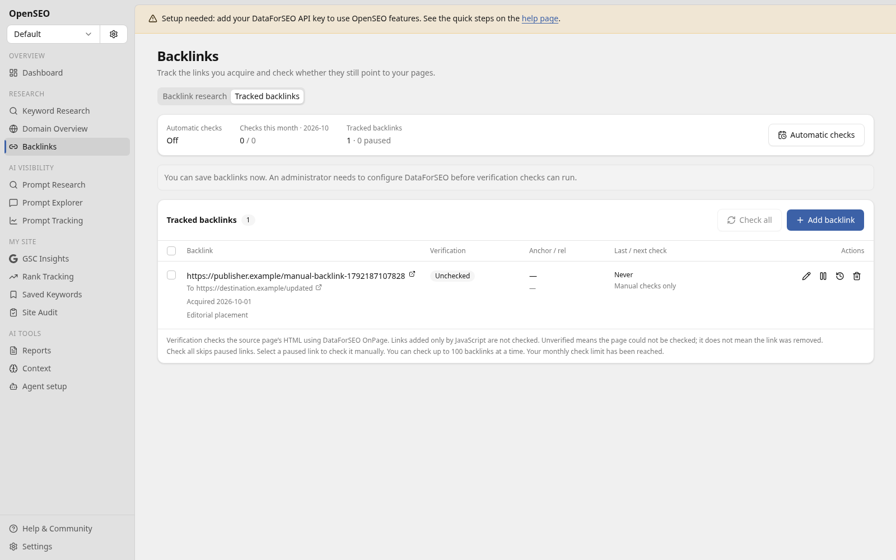

# Track backlinks you already know about

Use **Backlinks → Tracked backlinks** to save links from guest posts,
directories, and other pages without waiting for a backlink provider to
discover them. Each list belongs to an OpenSEO project.

## Add a link

Enter the source page URL and the target URL it should link to. You can also
save the acquisition date and notes. The same source/target pair cannot be
added twice within a project. Saving and editing the list does not call
DataForSEO.

A project can save up to 1,000 links. Source and target URLs each support up
to 1,000 characters after URL normalization. A manual batch can check up to
100 links at a time.

## Check a link

Configure DataForSEO using the existing [API key setup](DATAFORSEO_API_KEY.md),
then choose **Check**. Review the estimated cost before confirming. OpenSEO
uses DataForSEO OnPage to crawl the specified source page, with a one-page
limit. JavaScript execution, browser rendering, and resource loading are
disabled. Checks are paid provider operations; collecting an existing task's
results does not start another crawl.

OpenSEO reads the account's current crawl price before allowing checks. If
pricing cannot be verified, the saved list remains available, but new paid
checks are unavailable.

| Result            | Meaning                                                                                                          |
| ----------------- | ---------------------------------------------------------------------------------------------------------------- |
| Not checked       | No check has completed yet.                                                                                      |
| Checking          | A check is waiting for a provider result.                                                                        |
| Found             | The target link was observed in the source page's HTML.                                                          |
| Not found in HTML | The page was successfully checked, but the target link was not observed in its HTML.                             |
| Could not verify  | A crawl failure, blocked page, redirect, incomplete response, or another limitation prevented a reliable result. |

An HTML-only check cannot establish whether a link generated by JavaScript
appears in a visitor's browser. A missing result is not proof that the owner
removed the link. Redirected source URLs should be updated to their final
page URL before checking again.

The table shows the observed anchor text and link attributes. History retains
previous checks so you can compare results. When a page contains more than
one matching link, the displayed anchor and attributes describe one observed
match; they do not combine all matches into a synthetic link.

## Automatic checks

Automatic checks start disabled. Open the tracking settings to choose daily
or weekly checks and a monthly check limit. Saving an enabled schedule
authorizes paid checks; review the estimate first. Manual and automatic
checks share the limit, which resets at the start of each UTC calendar month.
Set the limit to zero to prevent new checks.

The approved estimate is saved with the schedule. If the current check price
increases, new automatic checks stop until you review and save the settings
again. The monthly check limit is a count limit; the displayed monthly cost is
an estimate based on the current price and list size.

Pause individual links to exclude them from automatic runs. You can still
request a manual check for a paused link. Turning off the schedule prevents
new scheduled checks; already submitted provider tasks still need to finish.

Scheduled work runs in bounded batches, so the planned time is not a promise
that every link completes at exactly that time. Provider availability and
the configured limit can delay or prevent a check.

Cloudflare deployments use the existing scheduled Worker handler. The Docker
image's existing scheduler also invokes that handler. A plain Vite development
server does not emit scheduled events by itself.

Hosted checks reserve usage credits before dispatch and reconcile them against
the completed provider task's actual cost. A submission with an uncertain
result is not automatically retried. If an older charge cannot be reconciled,
new checks can pause with a support message instead of silently risking
unaccounted spending.

## Relationship to backlink research

Tracked links are your project's inventory. They do not increase DataForSEO's
reported backlink counts or authority metrics, and checking a page does not
submit its links to DataForSEO's backlink index. Matching research results
can identify an already tracked source/target pair without another crawl.
